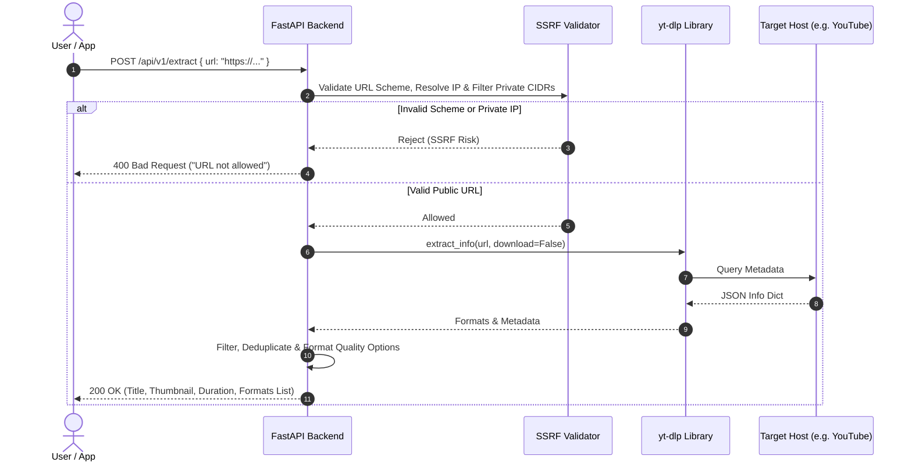
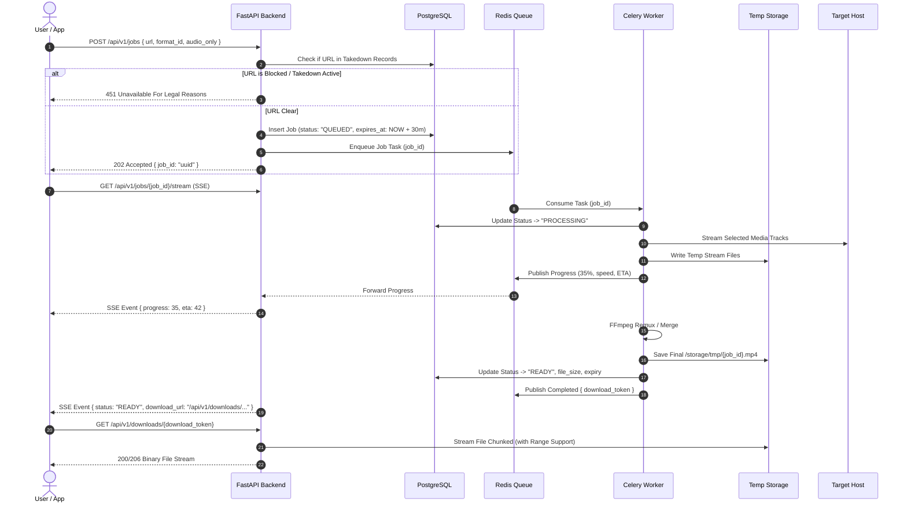

# OpenLoad / AnyStream Video Platform - Architecture & Specification

## 1. Executive Summary & Goals

The platform is a multi-platform media utility that allows users to paste a video URL, inspect media formats/qualities (from 144p to 4K and audio-only MP3/M4A), queue an extraction/download task, monitor live progress, and retrieve the processed media file.

The platform comprises:
1. **API Gateway & Processing Backend**: Python 3.12, FastAPI, yt-dlp (pure Python library mode, zero shell invocation), Celery + Redis, PostgreSQL.
2. **Web Client**: Next.js 14/15 App Router, React, TypeScript, Tailwind CSS, multi-language support (Bangla `bn` & English `en`), WCAG AA accessibility, Dark/Light modes.
3. **Mobile Client**: Flutter (Android + iOS, with direct APK distribution capability), local download manager with background execution and pause/resume.
4. **Infra & Security**: Reverse proxy (Nginx with TLS & strict headers), ephemeral sandboxed worker containers, automated TTL-based file garbage collection, and defense-in-depth against SSRF, RCE, and resource exhaustion.

---

## 2. High-Level Architecture

```mermaid
flowchart TD
    subgraph Clients["Clients"]
        Web["Web Client (Next.js / App Router)"]
        Mobile["Mobile Client (Flutter Android/iOS)"]
    end

    subgraph Edge["Edge & Ingress"]
        Nginx["Nginx Reverse Proxy & TLS Terminator"]
        WAF["Rate Limiter & Header Hardening"]
    end

    subgraph BackendCluster["Backend Services"]
        FastAPI["FastAPI API Server (Stateless)"]
        SSRF["SSRF Defense & URL Inspector"]
        Redis["Redis (Broker & Result Backend)"]
        Postgres[("PostgreSQL (Jobs, Takedowns, Abuse Logs)")]
        CeleryWorkers["Celery Worker Pool (Sandboxed Containers)"]
        TempStorage[("Temp Disk Storage (15-30 min TTL)")]
        Janitor["Janitor Daemon (Automated File Eviction)"]
    end

    subgraph Upstream["Target Video Platforms"]
        VideoHost["YouTube / Vimeo / Supported Sites"]
    end

    Web -->|HTTPS| Nginx
    Mobile -->|HTTPS| Nginx
    Nginx --> WAF
    WAF --> FastAPI

    FastAPI --> SSRF
    SSRF -.->|Verify IP/Host| VideoHost
    FastAPI -->|Extract Metadata (yt-dlp Lib)| VideoHost
    FastAPI -->|Write Job State| Postgres
    FastAPI -->|Publish Task| Redis

    Redis --> CeleryWorkers
    CeleryWorkers -->|Download Streams| VideoHost
    CeleryWorkers -->|Merge with FFmpeg| TempStorage
    CeleryWorkers -->|Update Progress/State| Redis
    CeleryWorkers -->|Finalize Record| Postgres

    Janitor -->|Prune Expired Files| TempStorage
    FastAPI -->|Serve Signed Media Stream| Nginx
```

---

## 3. Component Details & Responsibilities

### 3.1 API Server (FastAPI)
- **Role**: Validates requests, authenticates CAPTCHA tokens when needed, executes synchronous URL validation and metadata extraction, enqueues download jobs, and serves signed expiring download tokens.
- **SSRF Guard**: Pre-validates every incoming URL prior to extraction. Performs DNS resolution, checks against IANA-reserved, private, loopback, and link-local ranges, blocks cloud metadata endpoints (169.254.169.254, GCP/Azure metadata), and verifies against an optional domain allowlist/denylist.
- **yt-dlp Extraction**: In-memory metadata fetch using `yt_dlp.YoutubeDL({'extract_flat': False, 'skip_download': True})` without shell commands.
- **Communication Protocol**:
  - `POST /api/v1/extract`: Synchronous extraction of title, thumbnail, duration, and available quality options.
  - `POST /api/v1/jobs`: Asynchronous download submission.
  - `GET /api/v1/jobs/{job_id}`: Polling endpoint for progress and status.
  - `GET /api/v1/jobs/{job_id}/stream`: Server-Sent Events (SSE) for low-overhead live progress streaming.
  - `GET /api/v1/downloads/{token}`: High-speed streaming download with `Content-Disposition`, `Range` header support for resumable downloads, and automatic token expiry check.

### 3.2 Asynchronous Worker (Celery + Redis)
- **Role**: Heavy-duty media streaming, multiplexing (combining video stream + best audio stream via FFmpeg), and file packaging.
- **Execution Environment**:
  - Sandboxed non-root system user (`uid=10001`, `gid=10001`).
  - Read-only root filesystem with a dedicated ephemeral write volume (`/storage/tmp`).
  - Strict resource quotas in container definition (Memory limit: 1.5GB, CPU quota: 1.5 cores, max disk write per job: 2GB).
  - Task timeout enforced (hard timeout: 10 minutes, soft timeout: 8 minutes).
- **Process Communication**: Progress updates (`downloaded_bytes`, `total_bytes`, `speed`, `eta`, `percentage`) published via Celery task state and Redis pub/sub.

### 3.3 Storage & File Lifecycle
- **File Naming**: Absolute decoupling from user input. Files are saved as `<storage_dir>/<job_uuid>.<ext>`. Original titles are sanitized using strict alphanumeric + unicode filtering for the `Content-Disposition: attachment; filename="..."` header only.
- **TTL & Cleanup**:
  - Every file record in Postgres has an `expires_at` timestamp (default: `created_at + 30 minutes`).
  - An independent `janitor` daemon or Celery Beat periodic task runs every 5 minutes:
    - Finds all jobs where `expires_at < NOW()` or status is `failed`/`cancelled`.
    - Deletes files from `/storage/tmp`.
    - Updates job status to `expired`.
  - Startup reconciler: Any orphaned file on disk without an active database record is purged on service startup.

### 3.4 Relational Database (PostgreSQL)
- **Minimal Data Footprint**: To maintain privacy, user IP addresses are never stored in raw form. Only truncated cryptographic hashes (`HMAC-SHA256(ip, daily_salt)`) are stored for rate limiting and abuse mitigation.
- **Core Entities**:
  1. `download_jobs`: Tracks task lifecycle, quality parameters, file metadata, and expiration.
  2. `takedown_records`: Stores blocked URLs, video IDs, or channels subjected to DMCA or legal takedowns.
  3. `abuse_events`: Records anomalous request surges, failed CAPTCHA triggers, or malicious payloads to enable automated temporary IP throttling.

---

## 4. End-to-End Sequence Flows

### 4.1 URL Extraction Flow


### 4.2 Download Job & Streaming Flow


---

## 5. Technology Trade-offs & Architecture Decisions

| Decision Area | Selected Option | Considered Alternatives | Justification |
| :--- | :--- | :--- | :--- |
| **Worker Queue** | Celery + Redis | RQ, RabbitMQ, Kafka | Celery has first-class support for soft/hard task timeouts, task revocation (canceling downloads), and robust retry semantics. Redis acts as both broker and pub/sub transport for real-time progress. |
| **Execution Mode** | Pure Python library (`yt_dlp.YoutubeDL`) | Shell CLI execution (`subprocess.Popen`) | Invoking CLI strings opens injection vulnerabilities and path escaping issues. Using the native Python API guarantees typed configuration, in-process hooks for progress, and complete control over network handlers. |
| **Progress Transport** | SSE (Server-Sent Events) + Polling Fallback | WebSockets, Long Polling | SSE is unidirectional HTTP/2 friendly, natively handles reconnections, requires no custom socket protocol handshake, and operates reliably through corporate firewalls and mobile networks. |
| **Storage Architecture** | Local NVMe Ephemeral Volume with TTL Janitor | AWS S3 / Cloud Storage | For temporary video caching (15-30 min), local NVMe provides zero external egress cost, millisecond latency for FFmpeg merges, and strict privacy isolation since media never persists to external cloud buckets. |
| **Database** | PostgreSQL | MongoDB, SQLite | PostgreSQL provides ACID guarantees for job states, row-level locks for concurrent worker updates, native UUID generators, and robust indexing for IP rate limiting and DMCA hash queries. |
| **Frontend Framework** | Next.js (App Router, React 19) | Vite SPA, Nuxt | Server-side rendering provides superior SEO for public landing and legal pages, while client components handle the interactive state machine of downloading. |
| **Mobile Framework** | Flutter 3.x | React Native, Native Kotlin/Swift | Single codebase delivering consistent performance on both iOS and Android, robust background service capabilities for downloads, and seamless export of signed standalone APKs. |

