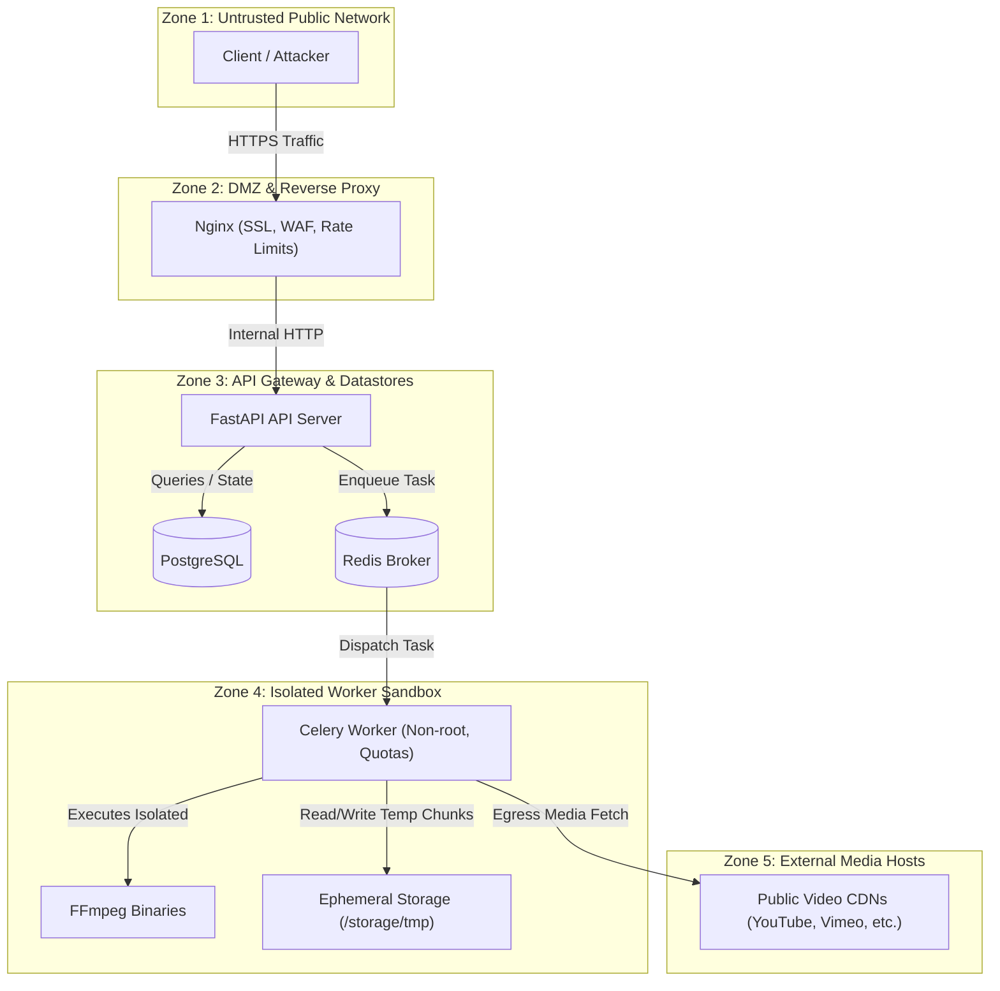

# Threat Model & Security Specification

## 1. System Overview & Trust Boundaries

The platform operates across four primary trust zones:
1. **Untrusted External Clients**: Web browsers, mobile apps, bots, and potential attackers providing unauthenticated user inputs (URLs, format choices, takedown requests).
2. **DMZ / Ingress Layer**: Reverse proxy (Nginx) terminating TLS, applying rate limits, and enforcing HTTP headers.
3. **Application Control Plane**: FastAPI API server verifying inputs, checking SSRF rules, authenticating CAPTCHAs, and managing state in PostgreSQL and Redis.
4. **Sandboxed Worker Pool**: Celery workers interacting with third-party media hosts and running media processing tools (FFmpeg, yt-dlp) in isolated, unprivileged containers.

---

## 2. STRIDE Threat Analysis Matrix

| Threat Category | Threat Scenario | Impact | Severity | Primary Mitigation |
| :--- | :--- | :--- | :--- | :--- |
| **Spoofing** | Attacker impersonates legitimate clients to exhaust quotas or bypass IP rate limits. | Rate-limit bypass, service abuse | Medium | Cryptographic IP hashing (`HMAC-SHA256`) + Cloudflare Turnstile CAPTCHA challenge on anomaly triggers. |
| **Tampering** | Attacker modifies file download URLs or parameters to access files belonging to other users. | Unauthorized file access | High | Signed, short-lived tokens (HMAC-SHA256) tied to random UUIDs with 15-minute TTL. No sequential IDs. |
| **Repudiation** | User denies uploading or triggering malicious URLs or takedown submissions. | Inability to audit abuse or resolve DMCA disputes | Low | Structured audit logs recording event types, timestamps, salted hashes, and cryptographic proof of takedown requests. |
| **Information Disclosure** | SSRF reveals internal cloud metadata (e.g. AWS `169.254.169.254`, GCP `metadata.google.internal`) or database credentials. | Cloud account takeover, credential leakage | Critical | Multi-stage SSRF validator (DNS pre-resolution, CIDR blacklisting, redirect validation, disabled local file schemes). |
| **Denial of Service** | Endless live stream downloads, 100GB 4K file requests, or massive concurrent extraction requests exhaust CPU, RAM, and disk. | Complete platform outage | High | Strict file size limit (max 2GB), duration limit (max 180 min), worker memory/CPU cgroups, and global concurrency caps. |
| **Elevation of Privilege** | Malicious video container exploits FFmpeg or yt-dlp vulnerability to escape to host system. | Host system compromise | Critical | Non-root container execution (`uid=10001`), read-only root filesystem, dropped Linux capabilities (`ALL`), no docker socket mount. |

---

## 3. Deep-Dive Security Controls & Defenses

### 3.1 Server-Side Request Forgery (SSRF) Defense

The application must accept URLs from arbitrary users. This poses severe SSRF risks if the server makes outbound requests to internal networks or cloud metadata APIs.

#### Multi-Layered SSRF Defense Architecture:
1. **Protocol Whitelisting**:
   - Only `http://` and `https://` schemes are permitted.
   - Prohibit `file://`, `ftp://`, `gopher://`, `dict://`, `ldap://`, etc.
2. **Domain & IP Blacklisting (Pre-Resolution & Post-Resolution)**:
   - Resolve hostname to all candidate IPv4/IPv6 addresses before initiating extraction.
   - Verify that *none* of the resolved addresses fall within the following forbidden CIDRs:
     - `0.0.0.0/8` (Current network)
     - `10.0.0.0/8` (Private network RFC 1918)
     - `100.64.0.0/10` (Carrier-grade NAT RFC 6598)
     - `127.0.0.0/8` (Loopback RFC 1122)
     - `169.254.0.0/16` (Link-local RFC 3927 - AWS/Azure/GCP metadata)
     - `172.16.0.0/12` (Private network RFC 1918)
     - `192.0.0.0/24` (IETF protocol assignments)
     - `192.0.2.0/24` (TEST-NET-1)
     - `192.168.0.0/16` (Private network RFC 1918)
     - `198.18.0.0/15` (Network benchmark tests)
     - `198.51.100.0/24` (TEST-NET-2)
     - `203.0.113.0/24` (TEST-NET-3)
     - `224.0.0.0/4` (Multicast)
     - `240.0.0.0/4` (Reserved)
     - `255.255.255.255/32` (Broadcast)
     - IPv6 equivalents: `::1/128` (Loopback), `fc00::/7` (Unique local), `fe80::/10` (Link-local), `::ffff:0:0/96` (IPv4-mapped IPv6 addresses).
3. **DNS Rebinding & Redirect Protection**:
   - Attackers can configure DNS servers to return a public IP on the initial check, then return `169.254.169.254` on redirect or second lookup.
   - Mitigated by:
     - Forcing custom network transport hooks in `yt-dlp` or wrapper requests that re-validate resolved IPs on every HTTP 3xx redirect.
     - Rejecting redirects that change hostnames to non-whitelisted domains.

---

### 3.2 Command Injection & Argument Injection Defense

- **Zero Shell Execution**: No user inputs are ever passed to `os.system()`, `subprocess.Popen(..., shell=True)`, or string-interpolated shell commands.
- **yt-dlp Library Mode**: The backend imports `yt_dlp.YoutubeDL` directly in Python. Options are passed as a strictly validated Python dictionary of native primitives (`bool`, `int`, `str`).
- **Pydantic Validation**: All inputs (URL, format IDs, audio options) are validated using strict regex patterns and whitelist enums. Format IDs must match `^[a-zA-Z0-9_-]{1,32}$`.

---

### 3.3 Path Traversal & Arbitrary File Overwrite

- **Decoupled Filenames on Disk**:
  - The file saved on disk is *never* named using the video title.
  - File path format: `/storage/tmp/{uuid4}.{ext}`.
  - The extension is validated against an allowlist: `{"mp4", "webm", "m4a", "mp3"}`.
- **Sanitized Download Filename**:
  - For the HTTP `Content-Disposition` header, the title is sanitized:
    - Stripped of directory separators (`/`, `\`), null bytes (`\0`), and path traversal tokens (`..`).
    - Stripped of non-printable or control characters.
    - Encoded using RFC 5987 / RFC 6266 `filename*=UTF-8''...` format.

---

### 3.4 Denial of Service (DoS) & Resource Exhaustion

1. **Job-Level Quotas**:
   - `max_filesize`: 2 GB limit per download. If yt-dlp detects stream size > 2 GB, download aborts immediately.
   - `max_duration`: 10,800 seconds (3 hours) maximum video length. Live streams (`is_live: true`) are rejected immediately.
2. **Timeouts**:
   - Format extraction timeout: 15 seconds.
   - Download worker timeout: 600 seconds (10 minutes) hard kill.
3. **Worker Isolation**:
   - Docker containers running workers have:
     - `mem_limit: 1.5g`
     - `cpus: 1.5`
     - Read-only root filesystem.
4. **Global & Per-IP Concurrency Caps**:
   - Maximum 2 active download jobs per IP hash at any moment.
   - Global worker queue depth monitoring: returns `503 Service Unavailable` with `Retry-After` if worker backlog exceeds queue threshold (e.g. 50 queued jobs).

---

### 3.5 DRM & Policy Safeguards

1. **DRM Content Rejection**:
   - Check format metadata for encrypted streams (`drm`, `widevine`, `playready`, `fairplay`).
   - If encrypted formats or DRM protection is detected, extraction aborts with a clear, user-facing error: `"This video is protected by DRM and cannot be processed."`
2. **DMCA / Takedown Ingestion & Blacklist**:
   - Admins and copyright owners can submit takedowns via `POST /api/v1/takedown`.
   - Verified takedowns insert URL hashes, exact URLs, and channel IDs into the `takedown_records` table.
   - Every request checks this blacklist before any network calls or worker dispatch.
3. **Terms of Service & Copyright Notice**:
   - Clear banner on both web and mobile: `"This utility is for personal backups, authorized content, and Creative Commons / public domain media. Downloading copyrighted media without permission is strictly prohibited."`

---

### 3.6 Mobile Security (Flutter)

1. **Certificate Pinning**:
   - The Flutter mobile app enforces TLS certificate / public key pinning for production API endpoints using `http` / `dio` with custom `SecurityContext`.
2. **Secure Local Storage**:
   - No sensitive tokens or secrets are stored in clear text.
   - Download history is stored exclusively on-device using encrypted local storage (`flutter_secure_storage` / encrypted SQLite).
3. **Android Storage & Scoped Storage Compliance**:
   - Complies with Android 13+ Scoped Storage permissions (`READ_MEDIA_VIDEO`, `READ_MEDIA_AUDIO`), saving downloaded files to public `Download/` folder without broad external storage permissions.

---

## 4. DREAD Risk Scoring

| Threat | Damage (1-10) | Reproducibility (1-10) | Exploitability (1-10) | Affected Users (1-10) | Discoverability (1-10) | Total DREAD Score |
| :--- | :--- | :--- | :--- | :--- | :--- | :--- |
| **SSRF to Cloud Metadata** | 10 | 8 | 7 | 10 | 8 | **8.6 / 10 (Critical)** |
| **Command Injection via URL** | 10 | 7 | 6 | 10 | 7 | **8.0 / 10 (High)** |
| **Worker Disk Exhaustion (DoS)** | 8 | 9 | 8 | 9 | 8 | **8.4 / 10 (High)** |
| **Path Traversal in Downloads** | 7 | 6 | 5 | 8 | 6 | **6.4 / 10 (Medium)** |
| **Rate Limit Evasion** | 4 | 7 | 8 | 4 | 8 | **6.2 / 10 (Medium)** |
| **DRM Bypass Request** | 6 | 8 | 3 | 2 | 7 | **5.2 / 10 (Low)** |

